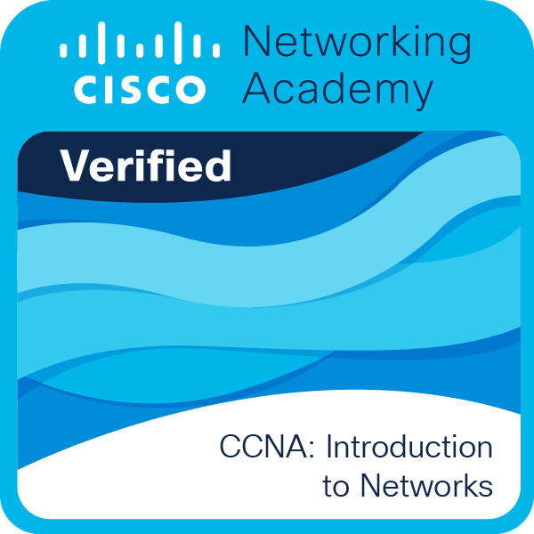

# CCNA: Introduction to Networks

Curso completado en Cisco Networking Academy (agosto 2026), a nombre de Paulo Javier García Arce.

**Verificar credencial:** [Ver badge en Credly](https://www.credly.com/badges/20818af4-81ce-465a-a405-baedbc1966e5)

## Qué cubre el curso

- Configuración de switches y routers.
- Direccionamiento IPv4 e IPv6.
- Protocolos de capa física y de enlace de datos (Ethernet).
- Capas superiores del modelo OSI.
- Configuración de una red pequeña con buenas prácticas de seguridad.
- Troubleshooting de conectividad.

Herramienta usada: Cisco Packet Tracer.
